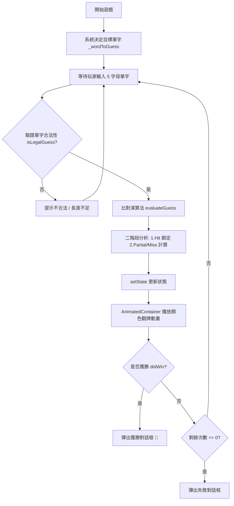

# Android 程式設計 (Android Program Design) — Flutter & Dart

[](https://flutter.dev)
[](https://dart.dev)
[]()
[]()

本專案為 **Android 程式設計** 課程教材與實作程式碼整理。以現代跨平台框架 **Flutter** 與 **Dart 程式語言** 為主軸，從零建置開發環境、掌握 Dart 核心與物件導向語法，循序漸進打造出具備動畫與狀態管理機制的五字母拼字益智遊戲 —— **Birdle**（仿 Wordle）。

---

## 📚 課程週次大綱 (Curriculum Index)

點選各週目錄可查閱該週的**詳細學習筆記**與**獨立範例程式碼**：

| 週次 | 主題模組 | 核心內容與關鍵字 | 範例與筆記連結 |
| :--- | :--- | :--- | :--- |
| **Week 1** | **Flutter 環境建置與 Dart 基礎** | Flutter SDK 安裝、VS Code 擴充套件、`flutter doctor`、`flutter create birdle --empty`、熱重載 (Hot Reload)、`const`、字串插值、函式呼叫 | [📁 Week 01 專題目錄](./week01_flutter_setup_and_dart_basics/) |
| **Week 2** | **Dart 空安全與非同步程式設計** | 健全空安全 (Sound Null Safety)、`?` 可空型態、`?.` 條件存取、`??` 空值合併運算子、`async` / `await`、HTTP GET 請求維基百科 API | [📁 Week 02 專題目錄](./week02_dart_null_safety_and_async/) |
| **Week 3** | **Dart 物件導向程式設計 (OOP)** | 類別與建構子語法糖 (`this.name`)、具名參數 (`{required this.no}`)、Getter 屬性存取器、抽象類別 (`abstract class`)、繼承 (`extends`)、方法覆寫 (`@override`) 與多型集合 | [📁 Week 03 專題目錄](./week03_dart_oop/) |
| **Week 4** | **Dart 特殊運算子 (Cascade & Spread)** | 級聯運算子 (`..` Cascade)、集合展開運算子 (`...` Spread)、空感知展開運算子 (`...?` Null-aware Spread) | [📁 Week 04 專題目錄](./week04_dart_operators/) |
| **Week 5** | **Flutter 組件樹與 Birdle 遊戲模型** | Android 模擬器管理 (`flutter emulators`)、組件樹 (Widget Tree) 解析、DevTools 調試工具、`lib/game.dart` (HitType, Word, Game 狀態機與二階段比對演算法)、自訂 `Tile` 方格元件 | [📁 Week 05 專題目錄](./week05_flutter_widgets_and_game_logic/) |
| **Week 6** | **使用者輸入與互動回調** | `TextField` 輸入框裝飾 (`InputDecoration`)、`TextEditingController` 文字控制、`FocusNode` 焦點自動請求、回調函式 (`onSubmitGuess`)、`IconButton` 送出按鈕 | [📁 Week 06 專題目錄](./week06_flutter_user_inputs/) |
| **Week 7+** | **狀態管理與平滑動畫** | `StatelessWidget` 升級為 `StatefulWidget`、`setState()` 驅動畫面重繪流程、控制器資源釋放 (`dispose()`)、`AnimatedContainer` 顏色漸變與 `bounceIn` 動畫曲線 | [📁 Week 07 專題目錄](./week07_flutter_state_and_animation/) |

---

## 🎮 核心專案：Birdle 拼字遊戲 (`birdle/`)

專案位於根目錄的 [`birdle/`](./birdle/)，為一個可直接建置與執行的完整 Flutter 應用程式。

### 遊戲規則
1. 系統由題庫中隨機挑選一個 5 字母英文單字（如 `aback`, `abase`, `abate`, `abbey`, `abbot`）。
2. 玩家共有 **5 次猜測機會**。
3. 每次輸入一個合法的 5 字母單字後送出，方格將以動畫翻牌顯示結果：
   - 🟩 **綠色 (Hit)**：字母正確，且位置完全吻合。
   - 🟨 **黃色 (Partial)**：單字中包含該字母，但不在目前位置。
   - ⬜ **灰色 (Miss)**：單字中不包含該字母。
4. 猜中所有字母即獲勝，用盡次數仍未猜中則遊戲結束，並顯示正確解答。



---

## 🛠️ 開發環境需求 (Prerequisites)

- **Flutter SDK**：3.10+ (推薦 3.13 以上)
- **Dart SDK**：3.0+
- **開發工具**：VS Code 或 Android Studio
  - 建議安裝 VS Code 擴充套件：
    - `Flutter` (Dart Code)
    - `Awesome Flutter Snippets`
- **目標平台**：
  - Android 模擬器 (AVD) / Android 實體裝置 (開啟 USB 偵錯)
  - 或 Chrome (Web)、Linux / Windows (Desktop)

---

## 🚀 快速上手 (Quick Start)

### 1. 複製專案
```bash
git clone https://github.com/CHUANG-CR/Android-Program-Design.git
cd Android-Program-Design
```

### 2. 執行每週 Dart 獨立範例
各週獨立範例無須啟動模擬器，可直接透過 Dart VM 執行：
```bash
# Week 01 基礎
dart run week01_flutter_setup_and_dart_basics/hello_world.dart
dart run week01_flutter_setup_and_dart_basics/function_basics.dart

# Week 02 空安全與非同步網路請求
cd week02_dart_null_safety_and_async
dart pub get
dart run null_safety.dart
dart run async_wikipedia.dart
cd ..

# Week 03 物件導向與多型
dart run week03_dart_oop/student_class.dart
dart run week03_dart_oop/animal_polymorphism.dart

# Week 04 級聯與展開運算子
dart run week04_dart_operators/cascade_operator.dart
dart run week04_dart_operators/spread_operators.dart
```

### 3. 執行完整 Birdle Flutter 遊戲
```bash
cd birdle

# 下載 Flutter 相依套件
flutter pub get

# 執行單元測試 (驗證遊戲模型與比對演算法)
flutter test

# 啟動應用程式 (可選擇 Chrome、Desktop 或 Android 模擬器)
flutter run
```

---

## 📁 專案檔案結構 (Project Structure)

```
Android-Program-Design/
├── README.md                            # 專案總覽與全課程指引
├── .gitignore                           # Git 忽略設定 (過濾 build、暫存與快取)
│
├── birdle/                              # 完整可遊玩 Flutter 專案
│   ├── lib/
│   │   ├── game.dart                    # Birdle 遊戲狀態機與核心比對演算法
│   │   └── main.dart                    # 整合版完整 UI (動畫、輸入、狀態管理)
│   ├── test/
│   │   └── game_test.dart               # 遊戲引擎單元測試 (5 個測試全數通過)
│   └── pubspec.yaml                     # Flutter 專案設定檔
│
├── week01_flutter_setup_and_dart_basics/# Week 1: 環境建置與 Dart 基礎
│   ├── README.md
│   ├── hello_world.dart
│   ├── function_basics.dart
│   └── main_empty.dart
│
├── week02_dart_null_safety_and_async/   # Week 2: 空安全與 async/await
│   ├── README.md
│   ├── pubspec.yaml
│   ├── null_safety.dart
│   └── async_wikipedia.dart
│
├── week03_dart_oop/                     # Week 3: 物件導向、繼承與多型
│   ├── README.md
│   ├── student_class.dart
│   └── animal_polymorphism.dart
│
├── week04_dart_operators/               # Week 4: Cascade 與 Spread 運算子
│   ├── README.md
│   ├── cascade_operator.dart
│   └── spread_operators.dart
│
├── week05_flutter_widgets_and_game_logic/ # Week 5: 組件樹與方格設計
│   ├── README.md
│   └── lib/
│       ├── game.dart
│       ├── main_tile.dart
│       └── main_gamepage.dart
│
├── week06_flutter_user_inputs/          # Week 6: 文字輸入與回調機制
│   ├── README.md
│   └── lib/
│       ├── game.dart
│       └── main_input.dart
│
└── week07_flutter_state_and_animation/  # Week 7: 狀態管理與動畫
    ├── README.md
    └── lib/
        ├── game.dart
        └── main.dart
```

---

## 💡 核心觀念總結 (Key Concepts)

1. **宣告式 UI vs 命令式 UI**：
   Flutter 透過 `UI = f(State)` 概念，只要改變內部資料狀態並呼叫 `setState()`，Flutter 便會自動比對並重新計算繪製最新的 Widget Tree，免除手動操作 DOM 或 View 的繁複程序。
2. **健全空安全 (Sound Null Safety)**：
   Dart 的型態系統在編譯期即杜絕 `null` 造成的執行時期錯誤（NullPointerException），透過 `?`、`?.`、`??` 與 `...?` 簡潔而安全地處理可空值。
3. **組件封裝與關注點分離**：
   - `Game`：純 Dart 業務邏輯，具備獨立性，易於撰寫單元測試。
   - `Tile`：純外觀展示與顏色過渡動畫。
   - `GuessInput`：負責鍵盤、輸入法聚焦與文字驗證。
   - `GamePage`：統整輸入事件與遊戲狀態。

---

## 📄 授權條款 (License)

本專案採 [MIT License](LICENSE) 授權，歡迎學習、教學與自由使用。
